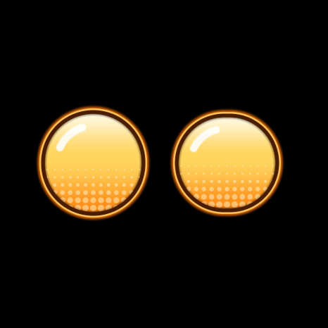
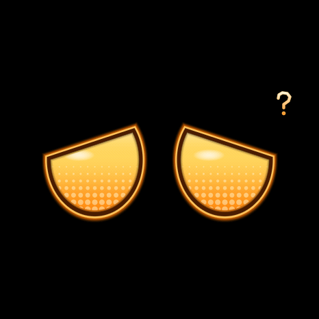
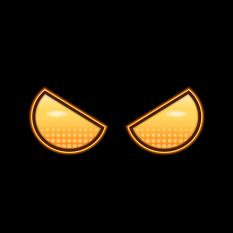
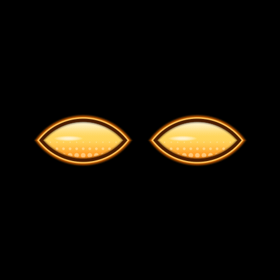
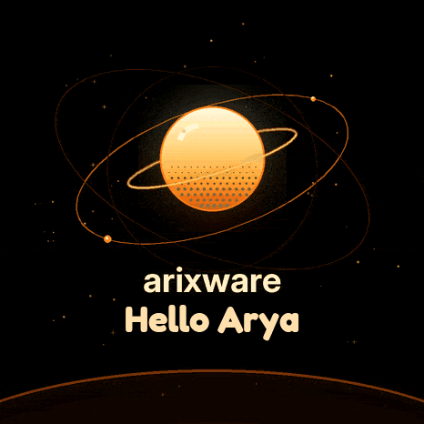
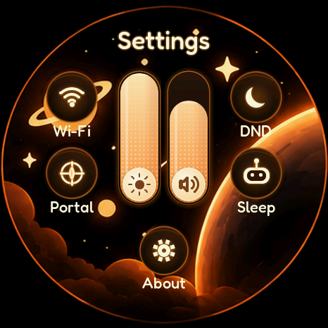

# Arixware

Arixware is desk companion firmware for the Waveshare ESP32-S3 Touch AMOLED 1.75 board.
It includes expressive eyes, sound, a clock, timers, alarms, quotes, and local Wi-Fi setup
and phone controls. The round display uses a 466 × 466 panel mounted at 90 degrees.

## Screenshots

Host-rendered previews of the actual firmware UI, shown upright at 466 × 466 pixels.
The welcome name and Wi-Fi details are sample test data, not live device credentials.

### Expressive eyes

<table>
  <tr>
    <td align="center"><br>Default</td>
    <td align="center"><br>Happy</td>
    <td align="center"><br>Curious</td>
  </tr>
  <tr>
    <td align="center"><br>Amazed</td>
    <td align="center"><br>Angry</td>
    <td align="center"><br>Sleeping</td>
  </tr>
</table>

### Panel screens

<table>
  <tr>
    <td align="center"><br>Welcome</td>
    <td align="center"><br>Settings</td>
    <td align="center"><br>Wi-Fi setup</td>
  </tr>
</table>

Capture details: [screenshot sources](docs/screenshots/README.md).

## Build

Install ESP-IDF 5.5 and its ESP32-S3 toolchain, then activate the ESP-IDF environment:

```sh
. /path/to/esp-idf/export.sh
idf.py set-target esp32s3
idf.py build
idf.py -p /dev/your-device flash monitor
```

The component manager downloads the dependencies declared in `main/idf_component.yml`.
`dependencies.lock` records the resolved versions for reproducible builds.
Internet access is required for the first build. `sdkconfig.defaults` contains the board
and partition defaults. Local `sdkconfig`, downloaded components, and build products are
ignored. Flashing replaces firmware on the selected device; select the correct serial port.
The firmware project name is `arix_deskbuddy`.

## Use and development

- [Wi-Fi setup and network behavior](docs/WIFI_SETUP.md)
- [Widget and display conventions](docs/WIDGETS.md)
- [Settings UI checks](tests/settings_ui/README.md)
- [Eyes preview and checks](tools/eyes_preview/README.md)
- [Welcome screen preview](tests/welcome/README.md)
- [Third-party materials](THIRD_PARTY_NOTICES.md)
- [Public release audit](docs/PUBLIC_RELEASE.md)
- [Security and privacy](SECURITY.md)

Host UI checks require the downloaded `managed_components/lvgl__lvgl` directory.
Run `idf.py reconfigure` in the ESP-IDF environment before running those checks on a fresh clone.
The quote and timezone tables are committed, so their generators are optional for normal builds.

## License

Original code and documentation are licensed under the [MIT License](LICENSE).
If you build on Arixware, please credit Arya Aghaei and link to this repository.
This credit is appreciated but is not an additional license requirement.

AI-generated images, sounds, splash animation, and original quotes are offered under MIT
to the extent copyright applies. Third-party materials retain their own licenses; see
[THIRD_PARTY_NOTICES.md](THIRD_PARTY_NOTICES.md).

The three dream animations and derived frame data use the included Lottie Simple License.
The public source and firmware include original quotes; the former collected quotes remain
in a private archive excluded from publication.
